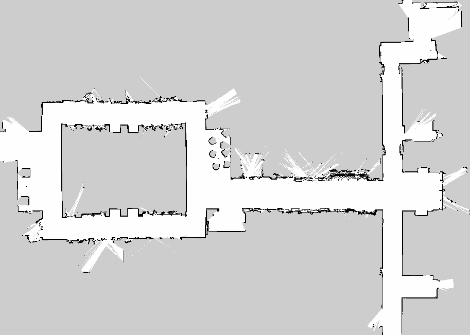
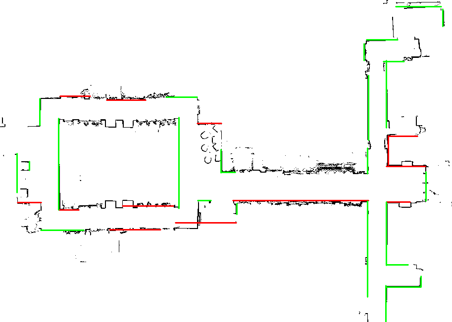
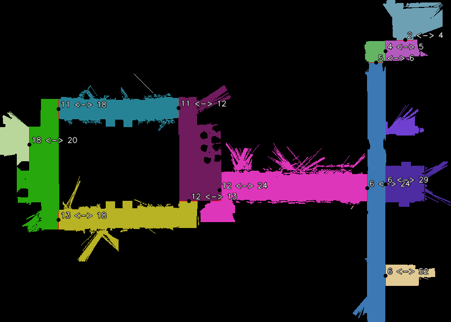

## 1. 引言

在移动清洁机器人的区域分割任务中，通常需要从栅格地图中提取墙体轮廓，通过识别水平或垂直方向的直线特征，为后续区域切割提供几何依据。

一种常见的处理流程为：

```text
输入栅格地图
     |
     v
地图预处理
     |
     v
提取轮廓
     |
     v
直线特征提取
     |
     v
直线二次拟合
     |
     v
相近直线合并
     |
     v
生成区域切割线
     |
     v
区域分割
```

但是，在实际 SLAM 地图中，墙体轮廓并不总是规则的直线。

受激光雷达测量噪声、建图误差、障碍物遮挡以及地图栅格化等因素影响，地图边界可能出现：

- 局部毛刺和不规则凸起。
- 墙体边界存在小范围断裂。
- 多段直线拟合后出现位置偏移。
- 不同直线合并后跨越较大空白区域。
- 拟合直线与实际轮廓存在较大偏差。

这些问题会导致区域切割线的质量下降，最终影响区域分割结果。

因此，在直线拟合和合并完成后，有必要增加一个独立的**直线特征质量评价模块**，对不可靠的切割线进行过滤。

本文介绍一种基于双向轮廓距离的直线质量评价方法，通过分析拟合直线与原始轮廓之间的几何关系，判断整条直线是否值得保留。

---

## 2. 问题描述

### 2.1 传统直线提取方法的局限

在区域分割过程中，可以使用 OpenCV 提取轮廓：

```cpp
cv::findContours(
    boundary_map.clone(),
    contours,
    cv::RETR_LIST,
    cv::CHAIN_APPROX_NONE);
```

随后使用 Douglas-Peucker 算法进行轮廓简化：

```cpp
cv::approxPolyDP(
    contour,
    approx,
    epsilon,
    true);
```

其中：

- `contour` 表示原始轮廓点集合。
- `approx` 表示简化后的多边形顶点。
- `epsilon` 表示轮廓近似允许的最大偏差。

通过连接相邻顶点，可以获得初步直线特征。

为了减少直线碎片，通常还会进行二次拟合和共线合并。

然而，这些操作主要解决的是直线的几何表达和冗余问题，并不能保证最终直线能够准确描述原始轮廓。

例如：

```text
原始轮廓：

           /\           /\
__________/  \_________/  \________

拟合直线：

------------------------------------
```

虽然拟合直线具有较好的方向一致性，但它与原始轮廓仍然存在明显偏差。

如果直接将这些直线用于区域切割，可能产生不合理的区域边界。

### 2.2 为什么不能只根据长度和角度判断？

传统直线筛选通常使用两个条件：

$$
L \geq L_{\min}
$$

$$
|\theta-\theta_{\text{target}}|\leq\theta_{\max}
$$

其中：

- $(L)$：线段长度。
- $(L_{\min})$：最小有效长度。
- $(\theta)$：线段方向。
- $(\theta_{\text{target}})$：水平或垂直方向。

但是，一条较长且方向正确的直线，并不意味着它一定对应真实墙体。

例如：

```text
原始轮廓：

*********                    *********

合并直线：

--------------------------------------
```

两段相距较远的墙线经过合并后，可能形成一条缺乏实际轮廓支撑的长直线。

因此，还需要评价直线与原始轮廓之间的匹配程度。

---

## 3. 核心思想：双向轮廓距离评价

对于最终合并得到的切割线，本文从两个方向评价其质量。

**方向一：拟合直线到原始轮廓。**

判断拟合直线的每个位置是否存在真实轮廓支撑。

**方向二：原始轮廓到拟合直线。**

判断实际轮廓与拟合直线之间的偏差程度。

两种评价具有不同的作用。

| 评价方向 | 核心问题 | 主要指标 |
|---|---|---|
| CutLine → Contour | 拟合直线是否有实际边界支撑？ | 支撑率、最大连续缺口 |
| Contour → CutLine | 原始轮廓是否接近拟合直线？ | RMSE、超差点比例 |

在工程实现中，首先为每条 CutLine 关联一个候选原始轮廓，再计算上述指标。

需要说明，这是一种基于空间位置的局部轮廓关联方法，并不等同于严格追踪直线拟合时使用的全部原始点。

---

## 4. CutLine 的几何表示

对于区域分割任务，可以将水平和垂直切割线统一表示为：

```cpp
struct CutLine
{
    bool horizontal;

    double pos;

    double min_v;
    double max_v;

    int support_count;
    double total_length;
};
```

其中，以上仅展示算法使用到的相关字段。

当：

```cpp
horizontal = true;
```

表示水平直线：

$$
y=pos
$$

定义域为：

$$
x\in[min_v,max_v]
$$

当：

```cpp
horizontal = false;
```

表示垂直直线：

$$
x=pos
$$

定义域为：

$$
y\in[min_v,max_v]
$$

直线长度统一表示为：

$$
L=max_v-min_v
$$

由于直线已经被约束为水平或垂直方向，因此不需要再次进行复杂的直线拟合。

对于水平线，轮廓点到直线的垂直距离为：
$$
d_i=|y_i-pos|
$$

对于垂直线：

$$
d_i=|x_i-pos|
$$

这种表达能够简化距离计算，提高算法执行效率。

---

## 5. 原始轮廓提取与关联

### 5.1 提取原始轮廓

首先对输入地图进行二值化：

```cpp
cv::threshold(
    boundary_map,
    binary_map,
    0,
    255,
    cv::THRESH_BINARY);
```

然后提取轮廓：

```cpp
std::vector<std::vector<cv::Point>> contours;

cv::findContours(
    binary_map.clone(),
    contours,
    cv::RETR_LIST,
    cv::CHAIN_APPROX_NONE);
```

选择 `CHAIN_APPROX_NONE` 的原因是希望保留尽可能完整的轮廓采样点。

这些点将用于后续直线质量评价。

需要注意，`findContours()` 默认从非零前景区域提取边界。如果地图使用黑色表示障碍物、白色表示自由空间，必须确认提取的是预期的区域轮廓，而不是将所有自由空间像素当作评价点。

### 5.2 为什么需要轮廓关联？

假设一条水平切割线附近同时存在两条平行墙面：

```text
上方轮廓：

*****************************

拟合直线：

-----------------------------

下方轮廓：

*****************************
```

如果直接统计搜索范围内的所有轮廓点，就可能把两条墙面同时加入质量评价。

这样会导致 RMSE 偏大，或者让不相关的轮廓为拟合直线提供错误支撑。

因此，需要先确定当前 CutLine 最可能对应哪个原始轮廓。

### 5.3 基于有效支撑范围的轮廓关联

对于每个原始轮廓，统计其中距离 CutLine 较近的点在直线投影方向上覆盖了多少采样位置。

例如，对于水平线：

$$
y=pos
$$

首先判断：

$$
min_v\leq x_i\leq max_v
$$

然后计算：

$$
d_i=|y_i-pos|
$$

如果：

$$
d_i\leq T_s
$$

则认为该点能够为 CutLine 提供候选支撑。

其中：

$$
T_s
$$

表示有效支撑距离阈值。

将 CutLine 按约 1px 间隔划分成若干采样区间，统计每条轮廓覆盖的有效区间数量。

最终选择有效支撑区间数量最多的轮廓。

需要强调，这种关联方法属于启发式方法。如果一条最终 CutLine 实际由多个独立轮廓合并得到，只选择一条轮廓可能导致误判。

---

## 6. 方向一：CutLine 到原始轮廓的距离评价

方向一主要判断：

**拟合直线是否真正受到原始轮廓的支持。**

### 6.1 沿 CutLine 均匀采样

假设一条 CutLine 的长度为：

$$
L
$$

以约 1px 的间隔进行采样：

$$
P_0,P_1,\ldots,P_{N-1}
$$

对于每个采样点，计算其到关联轮廓的最近欧氏距离：

$$
d_i=\min_{Q_j\in C}\|P_i-Q_j\|
$$

其中：

- $P_i$：CutLine 上的采样点。
- $C$：关联后的原始轮廓点集合。
- $Q_j$：原始轮廓点。
- $d_i$：采样点到最近轮廓点的距离。

### 6.2 使用 OpenCV 距离变换

为了避免对每个采样点遍历全部轮廓点，可以使用 OpenCV 的距离变换。

首先构造局部距离图：

```cpp
cv::Mat distance_input(
    roi.size(),
    CV_8UC1,
    cv::Scalar(255));
```

将关联轮廓的位置设置为 0：

```cpp
for (const auto &pt : source_contour)
{
    if (!roi.contains(pt))
        continue;

    distance_input.at<uchar>(
        pt.y - roi.y,
        pt.x - roi.x) = 0;
}
```

然后执行：

```cpp
cv::distanceTransform(
    distance_input,
    distance_map,
    cv::DIST_L2,
    cv::DIST_MASK_PRECISE);
```

距离图中的每个像素表示该位置到最近零值轮廓像素的距离。

后续可以直接查询：

```cpp
double distance =
    distance_map.at<float>(y, x);
```

这样能够减少重复距离计算。

### 6.3 有效支撑率

定义有效支撑条件：

$$
d_i\leq T_s
$$

则：

$$
s_i=
\begin{cases}
1,&d_i\leq T_s\\
0,&d_i>T_s
\end{cases}
$$

最终支撑率为：

$$
SupportRatio=
\frac{1}{N}\sum_{i=0}^{N-1}s_i
$$

例如：

```text
CutLine 总采样点：100

有效支撑点：85

SupportRatio = 0.85
```

说明 85% 的 CutLine 采样位置附近存在原始轮廓。

在第一版工程实现中，可以设置：

```cpp
min_support_ratio = 0.75;
```

当：

$$
SupportRatio<0.75
$$

则认为该线段缺乏足够支撑。

### 6.4 没有找到轮廓点怎么办？

这是评价算法中非常重要的问题。

如果某个采样位置在搜索距离内没有轮廓点：

```cpp
has_support = false;
```

该位置直接计为无支撑。

不能默认其距离为 0。

否则，一条大部分悬空的 CutLine 也可能得到较好的评价结果。

### 6.5 最大连续无支撑长度

仅使用支撑率还不够。

例如：

```text
情况 A：

**********----------**********
```

虽然前后有较长的轮廓支撑，但中间存在明显缺口。

因此，还需要统计最长连续无支撑区间。

定义：

$$
G_{\max}=
\max(\text{连续无支撑采样点数})\cdot\Delta s
$$

其中：

$$
\Delta s
$$

表示采样间距。

对应代码：

```cpp
if (has_support)
{
    max_gap_count = std::max(
        max_gap_count,
        current_gap_count);

    current_gap_count = 0;
}
else
{
    current_gap_count++;
}
```

最后：

```cpp
max_gap_count = std::max(
    max_gap_count,
    current_gap_count);
```

计算实际缺口长度：

```cpp
double max_gap_length =
    max_gap_count * sample_step;
```

如果连续缺口过长，可以认为这条 CutLine 可能存在错误合并。

---

## 7. 方向二：原始轮廓到 CutLine 的距离评价

方向二用于判断：

**实际轮廓是否能够被当前 CutLine 较好地描述。**

### 7.1 最初的 RMSE 计算方式

最初的实现是提取 CutLine 附近一定范围内的所有原始轮廓点。

计算每个点到 CutLine 的距离：

$$
d_i
$$

然后计算均方根误差：

$$
RMSE=
\sqrt{\frac{1}{N}\sum_{i=1}^{N}d_i^2}
$$

当 RMSE 较大时，认为拟合直线与原始轮廓偏差较大。

但是在实际测试中发现，该方法容易出现误删。

### 7.2 为什么会误删？

例如一条长度为 200px 的垂直墙线。

由于原始轮廓上存在局部凸起、拐角或者其他边界点，搜索带内可能包含 400 多个轮廓点。

如果将这些点全部加入 RMSE，就会造成两个问题。

第一，同一投影位置可能存在多个轮廓点，导致该位置被重复统计。

第二，远离主体墙面的凸起点会显著增加 RMSE。

最终可能出现：

```text
support_ratio = 1.0

max_gap = 0

rmse = 4.8

valid = false
```

也就是说，CutLine 的每个采样位置都有轮廓支撑，但仍然因为较高的 RMSE 被删除。

这并不一定表示算法计算错误，而是说明支撑率和 RMSE 衡量的是不同的几何关系。

如果目标是判断 CutLine 是否贴合主体墙面，就需要减少非主体轮廓点的影响。

### 7.3 改进：按投影位置分组

改进方法为：

**将原始轮廓点按照 CutLine 的投影位置进行分组，每个采样区间只保留距离 CutLine 最近的轮廓点。**

例如：

```text
水平 CutLine：

x = 100 ~ 200
y = 300
```

对于每个 x 位置，寻找距离 y=300 最近的轮廓点。

建立距离数组：

```cpp
std::vector<double> min_distances(
    sample_count,
    std::numeric_limits<double>::infinity());
```

遍历关联轮廓：

```cpp
for (const auto &pt : source_contour)
{
    const double projection =
        line.horizontal ? pt.x : pt.y;

    if (projection < min_v ||
        projection > max_v)
    {
        continue;
    }

    const double distance = std::abs(
        (line.horizontal ? pt.y : pt.x) -
        line.pos);

    if (distance >
        params.association_distance_px)
    {
        continue;
    }

    const int index = std::max(
        0,
        std::min(
            sample_count - 1,
            static_cast<int>(
                std::round(
                    (projection - min_v) /
                    sample_step))));

    min_distances[index] = std::min(
        min_distances[index],
        distance);
}
```

得到：

$$
d_i^{min}=\min_j d_{ij}
$$

然后计算：

$$
RMSE_{nearest}=
\sqrt{
\frac{1}{N_v}
\sum_{i\in V}(d_i^{min})^2
}
$$

其中：

- $V$：至少找到一个有效候选轮廓点的采样区间集合。
- $N_v$：有效区间数量。
- $d_i^{min}$：第 $i$ 个有效区间中最近轮廓点到 CutLine 的距离。

没有找到候选点的区间不参与该 RMSE 计算，而是由方向一的支撑率和缺口长度进行惩罚。

这样可以避免重复统计同一位置的多个轮廓点。

### 7.4 超差点比例

除了 RMSE，还可以统计最近距离超过阈值的区间比例。

定义：

$$
OutlierRatio=
\frac{N_{d>T_o}}{N_v}
$$

其中：

$$
T_o
$$

表示超差距离阈值。

例如：

```cpp
outlier_distance_px = 3.0;
```

当最近轮廓距离超过 3px 时，该有效采样区间被标记为超差。

如果：

```cpp
outlier_ratio > 0.15;
```

则认为拟合质量不满足要求。

需要注意，改进后的最近轮廓 RMSE 和超差比例主要衡量主体边界贴合程度。

它们不再能完整反映所有毛刺的突出高度，因为远离 CutLine 的毛刺点可能被同一投影位置的近距离点替代。

因此，严格意义上，该指标属于**最近轮廓匹配质量**，而不是完整原始轮廓的平直度评价。

---

## 8. 综合质量判断

最终使用四个指标：

$$
SupportRatio
$$

$$
G_{\max}
$$

$$
RMSE_{nearest}
$$

$$
OutlierRatio
$$

定义保留条件：

$$
Valid=
C_1\land C_2\land C_3\land C_4
$$

其中：

$$
C_1:SupportRatio\geq T_s
$$

$$
C_2:G_{\max}\leq T_g
$$

$$
C_3:RMSE_{nearest}\leq T_r
$$

$$
C_4:OutlierRatio\leq T_o
$$

只要其中任意一个条件不满足，就删除整条 CutLine。

对应代码：

```cpp
if (quality.support_ratio <
    params.min_support_ratio)
{
    quality.reject_reason = "low_support";
}
else if (
    quality.max_unsupported_length_px >
    params.max_unsupported_length_px)
{
    quality.reject_reason = "large_gap";
}
else if (
    quality.contour_rmse_px >
    params.max_contour_rmse_px)
{
    quality.reject_reason = "high_rmse";
}
else if (
    quality.outlier_ratio >
    params.max_outlier_ratio)
{
    quality.reject_reason = "high_outlier_ratio";
}
else
{
    quality.valid = true;
    quality.reject_reason = "accepted";
}
```

最后：

```cpp
if (quality.valid)
{
    valid_lines.push_back(line);
}
```

实现整条保留或整条删除。

需要注意，上述逻辑只能说明第一项失败原因。如果希望分析所有不满足的条件，应分别记录各项判断结果。

---

## 9. 实际工程调试与问题分析

### 9.1 第一版：过滤过于严格

初始测试中，39 条 CutLine 经过质量过滤后只保留了 2 条。

```text
total=39
valid=2
invalid=37
```

保留率约为：

$$
\frac{2}{39}\times100\%=5.13\%
$$

通过分析日志发现，不少直线具有较高的支撑率，但仍然因为 RMSE 较大而被删除。

例如：

```text
support=1.0
max_gap=0
rmse=4.82768
valid=0
reason=high_rmse
```

分析后认为，主要原因之一是搜索带内的多个原始轮廓点被重复计入 RMSE。

因此，将原来的全部轮廓点 RMSE 修改为按投影位置分组的最近轮廓 RMSE。

修改后，部分原本被误删的直线能够被保留，过滤结果有所改善。

### 9.2 第二版：长直墙仍然被误删

在后续测试中，发现部分较长、方向稳定的垂直墙线仍然被过滤。

这些墙线虽然整体连续，但局部存在小范围断裂或位置偏差。

由于最初使用固定的最大连续缺口阈值：

```cpp
max_unsupported_length_px = 8.0;
```

对于较长的墙体，这个条件可能过于严格。

一种改进方法是引入相对缺口长度。

定义：

$$
GapRatio=\frac{G_{\max}}{L}
$$

其中：

- $G_{\max}$：最大连续无支撑长度。
- $L$：CutLine 长度。

可以采用动态允许缺口：

$$
G_{allow}=
\min(
G_{cap},
\max(G_{base},\alpha L)
)
$$

例如：

```cpp
const double allowed_gap = std::min(
    20.0,
    std::max(8.0, length * 0.12));
```

这种方法在不无限放宽缺口限制的前提下，允许长墙体存在一定比例的局部断裂。

不过，动态缺口阈值也可能让部分跨越真实开口的错误合并线段通过，因此需要结合支撑率共同判断。

### 9.3 参数选择

工程调试可以从以下参数开始：

| 参数 | 初始值 |
|---|---:|
| 有效支撑距离 | 2.0px |
| 最低支撑率 | 0.75 |
| 最大连续缺口 | 8.0px |
| 轮廓关联距离 | 12.0px |
| 最大最近轮廓 RMSE | 2.0px |
| 超差距离阈值 | 3.0px |
| 最大超差比例 | 0.15 |

这些数值仅作为初始调试参数，不代表适用于所有地图的最优值。

实际使用时，需要结合地图分辨率、轮廓噪声以及区域切割要求进行调整。

建议每次只调整少量参数，并观察被删除直线的具体原因，避免同时修改多个阈值后无法定位问题。

---

## 10. 算法的局限性

虽然双向轮廓距离评价能够有效检测部分错误合并的直线，但它仍然存在一定局限。

### 10.1 最近距离不能完整反映毛刺

假设原始轮廓为：

```text
          *
          *
          *
******************************

拟合直线：
------------------------------
```

如果毛刺根部存在接近 CutLine 的轮廓点，那么最近距离仍然可能很小。

因此，即使：

$$
RMSE_{nearest}\approx0
$$

也不能证明原始轮廓没有毛刺。

如果后续需要专门检测毛刺，可以增加基于轮廓连续性的突出高度评价，例如分析局部轮廓点相对主体直线的最大偏移或高分位偏移。

但必须避免把真实墙角、障碍物侧边误判为毛刺。

### 10.2 轮廓关联存在歧义

目前使用空间位置为 CutLine 关联原始轮廓。

当多个墙体距离较近，或者一条 CutLine 来源于多个不同轮廓时，可能发生关联错误。

更可靠的方式是在首次直线提取时保存原始轮廓编号和原始点索引，并在直线合并过程中同步维护来源信息。

### 10.3 质量阈值与地图分辨率相关

所有评价距离均以像素为单位。

假设地图分辨率为：

$$
r=0.05m/px
$$

则：

$$
2px=0.10m
$$

不同地图分辨率下，直接使用相同像素阈值，会对应不同的物理距离。

因此，如果需要支持不同分辨率的地图，应该将物理距离阈值转换为像素距离：

$$
T_{px}=\frac{T_m}{r}
$$

### 10.4 单条轮廓可能包含多个几何结构

`findContours()` 返回的一条轮廓可能包含水平墙、垂直墙、转角和凸起。

仅靠线段投影范围与距离阈值，不一定能准确识别真正属于目标墙段的点。

这也是为什么工程中需要优先保证轮廓关联质量，而不是单纯反复调整 RMSE 阈值。

---

## 11. 总结

本文针对移动清洁机器人区域分割过程中，直线拟合与合并后出现的几何质量问题，设计了一种基于双向轮廓距离的 CutLine 质量评价方法。

算法主要包含四个部分。

**第一，原始轮廓关联。**

根据 CutLine 的位置和有效支撑范围，寻找最可能对应的原始轮廓。

**第二，直线支撑评价。**

沿 CutLine 进行均匀采样，利用距离变换计算每个采样位置到关联轮廓的距离，并统计支撑率及最大连续无支撑长度。

**第三，轮廓匹配评价。**

根据水平或垂直方向，将原始轮廓点按照投影位置分组，计算每个位置的最近轮廓距离，并进一步得到 RMSE 和超差比例。

**第四，整条直线过滤。**

对所有评价指标设置阈值，只保留满足要求的 CutLine，避免明显不可靠的几何特征参与后续区域分割。

整体流程为：

```text
原始栅格地图
      |
      v
轮廓提取
      |
      v
直线特征提取
      |
      v
二次拟合与合并
      |
      v
CutLine 质量评价
      |
      +---- 轮廓关联
      |
      +---- 支撑率评价
      |
      +---- 连续缺口评价
      |
      +---- 最近轮廓 RMSE
      |
      +---- 超差点比例
      |
      v
不合格 CutLine 整条删除
      |
      v
有效 CutLine
      |
      v
区域切割与分割
```

在实际工程中，最重要的经验是：

**直线几何形状规则，不代表它一定能够准确描述地图边界。**

通过增加独立的直线质量评价模块，可以在直线拟合和区域分割之间建立一道几何有效性检查，减少错误切割线对区域分割结果的影响。

与此同时，直线质量评价也需要在误删真实墙线和保留虚假线段之间进行权衡。

对于较长、整体方向稳定、局部存在少量噪声的真实墙体，应适当提高容错能力；对于缺乏连续轮廓支撑、存在明显错误合并的线段，则应优先过滤。

后续可以进一步引入轮廓来源追踪、局部突出度分析以及自适应质量阈值，提高算法在复杂室内环境中的稳定性。

## 12 测试效果

走廊等场景建立的地图如下所示：




原始提取并合并直线的效果以及滤除直线的效果如下图所示，其中绿色代表合适，红色代表滤除：




最终的效果图：


